  <a href="https://xsaikat.vercel.app/">Portfolio</a> &nbsp;·&nbsp;
  <a href="https://linkedin.com/in/saikat933">LinkedIn</a> &nbsp;·&nbsp;
  <a href="mailto:ibx.saikat37@gmail.com">Email</a> &nbsp;·&nbsp;
  <a href="https://github.com/X-Saikat-93">GitHub</a>

  <a href="https://zaruro.com">Zaruro ↗</a> &nbsp;·&nbsp;
  <a href="https://finbird.netlify.app/">Finbird ↗</a> &nbsp;·&nbsp;
  <a href="https://xsaikat.vercel.app/">Portfolio ↗</a>

<picture>
  <source media="(prefers-color-scheme: dark)" srcset="https://raw.githubusercontent.com/X-saikat-93/X-saikat-93/output/github-contribution-grid-snake-dark.svg" />
  <source media="(prefers-color-scheme: light)" srcset="https://raw.githubusercontent.com/X-saikat-93/X-saikat-93/output/github-contribution-grid-snake.svg" />
  
</picture>

  
  
  
  

